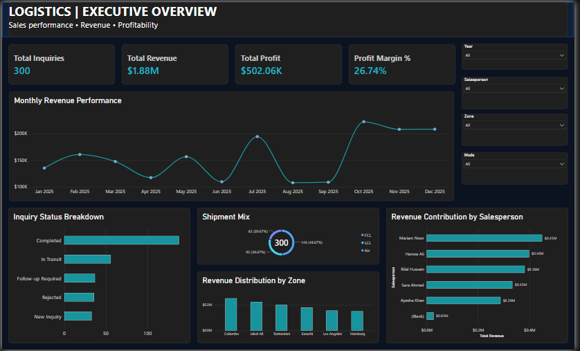

# Logistics Sales Intelligence Dashboard

### End-to-End Data Analytics Project | Python • SQL Server • Power BI

## Project Overview

An end-to-end data analytics project developed using a synthetic logistics dataset containing 300 records.

The project demonstrates how logistics inquiry and shipment data can be transformed into actionable business insights through Python, SQL Server, and Power BI.

## Dashboard Preview

## Dashboard Features

The interactive Power BI dashboard includes:

- Total Inquiries
- Total Revenue
- Total Profit
- Profit Margin
- Monthly Revenue Performance
- Revenue Contribution by Salesperson
- Shipment Mix
- Inquiry Status Breakdown
- Revenue Distribution by Zone

## Business Questions Answered

1. How much revenue and profit are recorded?
2. How does revenue change month by month?
3. Which salespeople contribute the most revenue?
4. Which shipment modes receive the most inquiries?
5. Which zones generate the highest revenue?
6. What is the distribution of inquiries across different job statuses?

## Tools & Technologies

| Tool | Purpose |

| Python | Data exploration and analysis |
| Pandas | Data manipulation |
| SQL Server | Data storage and querying |
| SSMS | SQL query development |
| Power BI | Dashboard development |
| Power Query | Data transformation |
| DAX | Business KPI calculations |

## Repository Structure

- data/ — Synthetic logistics dataset
- python/ — Python analysis
- sql/ — SQL queries
- Powerbi/ — Power BI dashboard
- Screenshots/ — Dashboard preview

## Dataset Disclaimer

This project uses synthetic data created for educational and portfolio purposes. It does not contain confidential business information.

Revenue and profit reflect recorded values in the simulated dataset rather than verified financial transactions.

## Author

Nimra Shahab

Data Analyst | Business Intelligence | Python Automation
